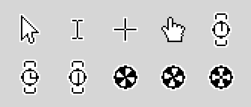

# Classic Mac Cursors

A [Zen Browser](https://zen-browser.app) mod that replaces the mouse cursors with the classic Mac OS ones:
black-and-white arrow, pointing hand, I-beam and crosshair, plus a loader cursor.



## Options (Zen settings > Mods)

| Option | Values |
| --- | --- |
| Cursor size | 1x, 2x (default), 3x |
| Loader style | Wristwatch (System 7, default), Spinning ball |
| Loader animation | Animated (default), Static |

## Install

**Browser UI (the mod itself)**

- From the Zen mods store once published, or locally: Zen settings > Mods > import `theme.json` / `chrome.css`.

**Web pages (optional)**

Zen mods only style the browser UI, so page content needs a `userContent.css`:

```sh
scripts/install-content.sh 2      # size 1, 2 or 3; installs into your most recent Zen profile
```

Then restart Zen. This requires `toolkit.legacyUserProfileCustomizations.stylesheets = true` (Zen's default).
The size is fixed at install time because `userContent.css` cannot read mod preferences.

## Develop

`chrome.css`, `dist/userContent.css` and `image.png` are generated; edit the ASCII art in `src/cursors/` or `scripts/build.py`, then:

```sh
python3 scripts/build.py
```

ASCII legend: `X` black, `o` white, `-` transparent. `halo: yes` adds the white outline.

## Limitations

- Pages that set `cursor: wait`/`progress` through a stylesheet class can't be re-skinned from CSS; only inline styles and the browser's own busy states are matched.
- The loader animation uses CSS keyframes on `cursor`; Firefox only refreshes the cursor when it is redrawn (e.g. when the mouse moves), so it may look stepped.
- Resize / grab / drag cursors keep the system look.
